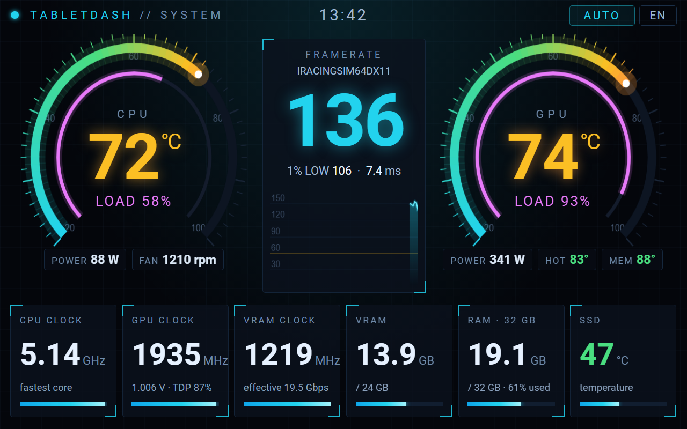
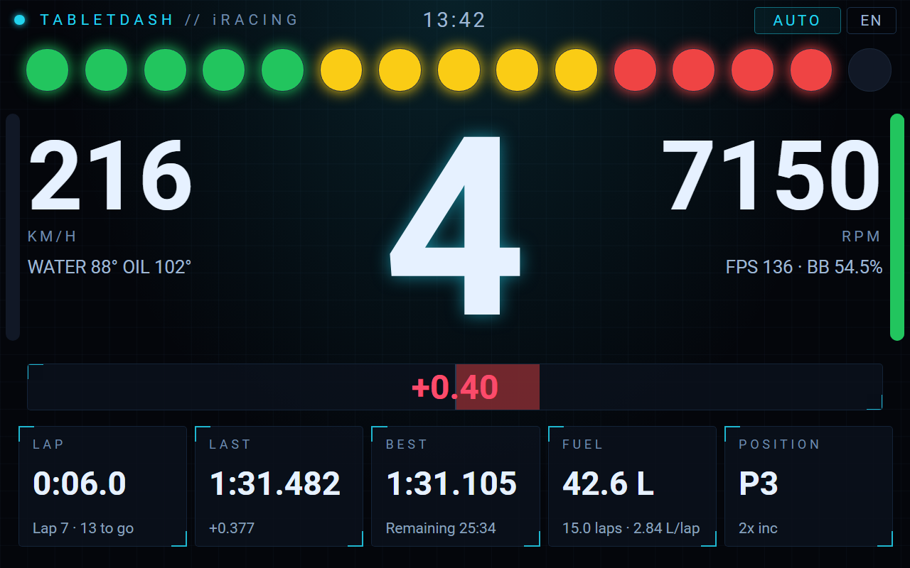

# TabletDash

Turn an old Android tablet (or any device with a browser) into a live **PC hardware monitor** and **iRacing dashboard**.

Built and tested on a Samsung Galaxy Tab 3 (SM-T310, Android 4.4) that sat in its box for 10 years.

*Türkçe açıklama aşağıda.*





<sub>Screenshots use the built-in demo data (`/?demo`).</sub>

## Features

**PC screen**
- Circular CPU / GPU gauges: temperature (outer ring) and load (inner ring), animated
- FPS with 1% low and frame time, plus a 90-second FPS graph (via RTSS or HWiNFO's PresentMon sensor)
- CPU clock (fastest core), GPU clock + voltage + TDP %, VRAM clock + effective Gbps
- VRAM / RAM usage, SSD temperature, GPU hot spot and memory junction temps, fans

**iRacing screen** (switches automatically when you get in the car)
- 15 shift lights using each car's own RPM thresholds from iRacing
- Gear, speed, RPM, throttle / brake bars
- Delta to best lap, current / last / best lap times
- Fuel, average fuel per lap and laps remaining
- Position, incidents, pit limiter warning, flag-colored border

**Languages:** English and Turkish. The dashboard follows the device language; tap the **EN / TR** button to switch, or open `/?lang=en`.

## How it works

```
PC: HWiNFO shared memory + iRacing SDK shared memory
      -> TabletDash.exe (tiny HTTP server, port 8080)
      -> Wi-Fi
Tablet: browser page (plain ES5, works on Android 4.4)
```

No app is installed on the tablet. The page polls `/data` over a keep-alive connection, which recovers quickly when old Wi-Fi chips drop packets.

## Requirements

- Windows 10/11 (.NET Framework 4, built into Windows)
- [HWiNFO64](https://www.hwinfo.com/) with **Shared Memory Support** enabled
- iRacing (optional)
- RTSS (optional, for in-game FPS)

## Setup

1. Build: `powershell -ExecutionPolicy Bypass -File build.ps1` (uses the C# compiler that ships with Windows)
2. Allow the port on your home network (run PowerShell as administrator, once):
   ```
   New-NetFirewallRule -DisplayName "TabletDash 8080" -Direction Inbound -Protocol TCP -LocalPort 8080 -RemoteAddress LocalSubnet -Action Allow
   ```
3. In HWiNFO64: Sensors-only → Settings → tick **Shared Memory Support**
4. Run `start.bat`. The console prints the address to open, e.g. `http://192.168.1.10:8080`
5. Open that address in the tablet's browser. Add it to the home screen for full screen.

Debug helpers: `/?demo` shows fake data, `/?demo&race` shows the race screen (add `&rpm=7150` to freeze the RPM), `/sensors` lists every HWiNFO sensor.

Note: the free version of HWiNFO turns shared memory off after 12 hours; re-enable it in settings.

---

## Türkçe

Eski bir Android tableti (veya tarayıcısı olan herhangi bir cihazı) **PC sıcaklık ekranına** ve **iRacing göstergesine** dönüştürür. Tablete hiçbir şey kurulmaz, sadece tarayıcıda sayfa açılır.

**Kurulum:**
1. `build.ps1` ile derle.
2. Yönetici PowerShell'de yukarıdaki güvenlik duvarı komutunu bir kez çalıştır.
3. HWiNFO64'te **Paylaşılan Bellek Desteği**'ni aç.
4. `start.bat`'ı çalıştır, pencerede yazan adresi tabletin tarayıcısında aç.

Arayüz cihazın diline göre Türkçe veya İngilizce açılır; sağ üstteki **EN / TR** düğmesiyle değiştirilebilir.

## License

MIT
